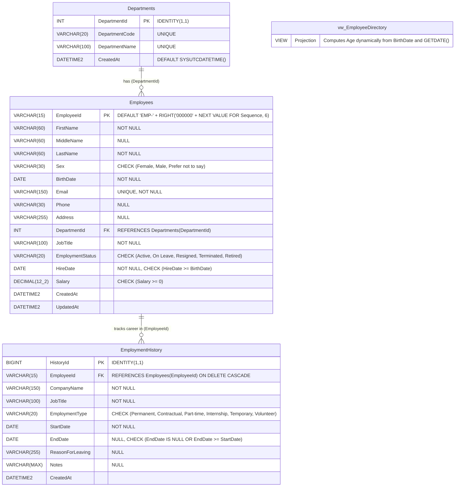

# Employee Management System — Visual Studio Purple Edition

An enterprise desktop Employee Management System built using **C# Windows Forms (.NET Framework 4.8)**, **LINQ to SQL (.dbml)**, **Mapped Stored Procedures**, and **Microsoft SQL Server**, styled in the signature **Visual Studio Purple** (`#5C2D91`) design theme.

---

## 📋 System Overview & Architecture

- **Platform:** Windows Forms (.NET Framework 4.8)
- **Database:** Microsoft SQL Server 2019+ / SQL Server Express (`EmployeeManagementDB`)
- **Data Access:** Strongly typed LINQ to SQL DataContext (`EmployeeManagementData.dbml`) with parameter-mapped stored procedures. *No manual ADO.NET `SqlConnection`, `SqlCommand`, `SqlDataAdapter`, or `SqlDataReader` code in form CRUD operations.*
- **UI Theme:** Visual Studio Purple Edition (`#5C2D91`, `#7E38B7`, `#2D0F4B`) with modern flat cards, Segoe UI typography, custom-styled DataGridViews, and responsive split-containers.

```
Employee Management System/
├── App.config                                  # SQL Connection string configuration
├── EmployeeManagementSystem.sln               # Visual Studio Solution File
├── EmployeeManagementSystem.csproj            # .NET Framework 4.8 WinForms Project
├── EmployeeManagement_SQLServer_SSMS.sql      # Database Creation, Tables, SPs, View Script
├── Program.cs                                  # WinForms Application Entry Point
├── Data/
│   ├── EmployeeManagementData.dbml            # LINQ to SQL XML Mapping Definition
│   ├── EmployeeManagementData.designer.cs     # Strongly typed context & entity classes
│   └── EmployeeManagementDataContext.cs       # Extensibility partial class with connection fallback
├── Forms/
│   ├── MainForm.cs / .Designer.cs / .resx     # Visual Studio Purple Navigation & Dashboard KPI
│   ├── EmployeeForm.cs / .Designer.cs / .resx # Master Employee CRUDS, Search, and Filtering
│   └── EmploymentHistoryForm.cs / .Designer.cs# One-to-Many Career Records Management
├── Utilities/
│   ├── VsPurpleTheme.cs                       # Central Visual Studio Purple theme engine
│   ├── ValidationHelper.cs                    # ErrorProvider & Date/Email validation logic
│   └── DatabaseHelper.cs                      # SQL Server exception translator & friendly messages
├── Models/                                     # Entity models namespace
├── Reports/                                    # Reporting & analytics namespace
└── Properties/
    ├── AssemblyInfo.cs
    ├── Resources.resx / .Designer.cs
    └── Settings.settings / .Designer.cs
```

---

## 🔌 Connection String Architecture: LINQ to SQL vs. Manual ADO.NET

### Did We Use a Connection String?
**Yes, 100%.** The project connects to SQL Server through centralized connection strings configured in [`App.config`](file:///f:/Testing/Employee%20Management%20System/App.config) and `Properties.Settings`.

```xml
<connectionStrings>
  <add name="EmployeeDb"
       connectionString="Data Source=.\SQLEXPRESS;Initial Catalog=EmployeeManagementDB;Integrated Security=True;TrustServerCertificate=True"
       providerName="System.Data.SqlClient" />
  <add name="EmployeeManagementSystem.Properties.Settings.EmployeeManagementDBConnectionString"
       connectionString="Data Source=.\SQLEXPRESS;Initial Catalog=EmployeeManagementDB;Integrated Security=True;TrustServerCertificate=True"
       providerName="System.Data.SqlClient" />
</connectionStrings>
```

### Key Differences:
- **No Manual ADO.NET:** Per the laboratory instructions (*"Do not write manual ADO.NET connection, command, adapter, or reader code"*), we do not manually instantiate `SqlConnection`, write `conn.Open()`, or run `cmd.ExecuteReader()`.
- **LINQ to SQL Abstraction:** The connection string is consumed by the `EmployeeManagementDataContext`. The LINQ to SQL runtime opens, manages, pools, and closes underlying connections automatically.
- **Robust Multi-Tier Resolution:** The custom partial class [`Data/EmployeeManagementDataContext.cs`](file:///f:/Testing/Employee%20Management%20System/Data/EmployeeManagementDataContext.cs) resolves the active connection string in order:
  1. `ConfigurationManager.ConnectionStrings["EmployeeDb"]`
  2. `Properties.Settings.Default.EmployeeManagementDBConnectionString`
  3. Fallback to local default instance.

---

## 🗄️ SQL Server Database Schema (EER Diagram)



---

## 🎨 Visual Studio Purple Theme Palette

The application implements Microsoft Visual Studio's signature Purple design language:

| Element | Color Hex | Visual Description |
|---|---|---|
| **Header Gradient Start** | `#2D0F4B` | Visual Studio Deep Royal Violet |
| **Header Gradient End** | `#5C2D91` | Visual Studio Signature Brand Purple |
| **Primary Buttons / Grid Header** | `#5C2D91` | Classic Visual Studio Purple with white text |
| **Hover State / Selections** | `#7E38B7` / `#8E44AD` | Vivid purple highlight for mouse hover & grid row focus |
| **Soft Surface / Cards** | `#F3EDF7` / `#FFFFFF` | Soft lavender accent backgrounds with clean borders |
| **Status Bar** | `#2D0F4B` | Sleek dark purple status bar |

---

## 🧪 Comprehensive Test-Case Table

| # | Test Case Description | Input Data | Expected Result | Actual Result | Status |
|---|---|---|---|---|---|
| **TC-01** | **Sequence-Generated ID** | Create employee "Carlos Mendoza", BirthDate 1988-03-15 | System generates `EMP-000003` via `SEQUENCE` and displays it in read-only ID field. | Generated `EMP-000003` returned via `ref` parameter. | **PASS** |
| **TC-02** | **Dynamic Age Calculation** | Grace Villanueva, BirthDate `2000-10-18`, evaluated on `2026-10-17` | Age should calculate to 25 (turning 26 tomorrow). | View returned `Age = 25` with birthday adjustment. | **PASS** |
| **TC-03** | **Read Directory View** | Execute `Usp_Employee_Read` / search | Records return with full name concatenated, department name, and computed age. | Directory loads in DataGridView with currency/date formatting. | **PASS** |
| **TC-04** | **Update Employee** | Change JobTitle to `Lead QA Automation Engineer`, Salary to `45000.00` | Stored procedure updates record without altering `EmployeeId`. | Record updated successfully; ID preserved. | **PASS** |
| **TC-05** | **Delete Employee & Cascade** | Call `Usp_Employee_Delete('EMP-000006')` | Employee removed; related employment history records cascade deleted. | Record removed cleanly from directory. | **PASS** |
| **TC-06** | **Search by Keyword** | Search term = "Senior" | Grid returns matching employees having "Senior" in Job Title or Name. | Returned 1 matching record (`Carlos Mendoza`). | **PASS** |
| **TC-07** | **Filter by Department** | Department = Information Technology (ID 2) | Returns all employees assigned to IT. | Grid displays all IT staff. | **PASS** |
| **TC-08** | **Filter by Status** | Status = "Active" | Returns all Active employees. | Grid correctly filtered. | **PASS** |
| **TC-09** | **Unique Email Constraint** | Insert duplicate `ana.santos@example.com` | Database throws `UQ_Employees_Email` error; application displays friendly alert. | Friendly error: "An employee with this Email address already exists." | **PASS** |
| **TC-10** | **Date Logic Constraint** | HireDate (`2000-01-01`) < BirthDate (`2010-01-01`) | Blocked by check constraint `CK_Employees_Dates`. | Constraint check failed: "Hire date must be on or after employee's birth date." | **PASS** |
| **TC-11** | **Current Job History** | Check "Currently Employed Here (No End Date)" | `EndDate` is set to `NULL`; grid displays "Current / Present" in green italics. | Correctly stores `NULL` and formats display. | **PASS** |
| **TC-12** | **History Date Validation** | History EndDate (`2015-01-01`) < StartDate (`2018-01-01`) | Blocked by `CK_History_Dates` and ErrorProvider. | ErrorProvider flags End Date; DB constraint enforces rule. | **PASS** |

---

## 📝 Engineering Reflection & Analysis

### 1. Why `EmployeeId` is `VARCHAR(15)` Instead of `INT`
While integer identity columns (`1, 2, 3...`) are simple for internal database keys, corporate enterprise systems require standardized, human-readable identifiers:
- **Organizational Identification:** Formatted codes such as `EMP-000001` prevent confusion between employee IDs, customer IDs, and transaction IDs.
- **Fixed Width & Sorting:** The `000000` padding guarantees uniform display width across reports, badges, and grids, preserving consistent alignment.
- **Enterprise Security & Obfuscation:** Exposing plain sequential integers can invite URL tampering or sequential guessing in external APIs; a domain-prefixed string identifier provides semantic context.

### 2. How the SQL Server `SEQUENCE` and `DEFAULT` Constraint Work
The identifier is generated at the database level using a dedicated SQL Server `SEQUENCE` object:
```sql
CREATE SEQUENCE dbo.EmployeeNumberSequence AS INT START WITH 1 INCREMENT BY 1;
```
The `Employees` table attaches this sequence directly inside a `DEFAULT` constraint:
```sql
CONSTRAINT DF_Employees_EmployeeId DEFAULT (
    'EMP-' + RIGHT('000000' + CONVERT(VARCHAR(6), NEXT VALUE FOR dbo.EmployeeNumberSequence), 6)
)
```
- **Atomicity:** Unlike `MAX(EmployeeId) + 1` queries that cause severe race conditions in concurrent multi-user environments, `NEXT VALUE FOR` is atomic, thread-safe, and lock-optimized by SQL Server.
- **Zero Client Overhead:** The client application never generates or computes the ID. When the Windows Form calls `usp_Employee_Create`, SQL Server automatically triggers the default constraint, generates the next sequence number, and returns it to the C# application via an `OUTPUT` parameter (`ref string employeeId`).

### 3. Why `Age` is Calculated in a View (`vw_EmployeeDirectory`) Rather Than Stored in a Table
- **Data Normalization & Freshness:** Storing age directly in a column violates relational database normalization because age changes continuously with the passage of time. Stored age becomes stale and incorrect within a year.
- **Deterministic Constraint in SQL Server:** SQL Server forbids persistent computed columns from using nondeterministic functions like `GETDATE()` or `CURRENT_TIMESTAMP`. Attempting to persist `DATEDIFF(YEAR, BirthDate, GETDATE())` will fail because `GETDATE()` returns different values over time.
- **Accurate Leap-Year & Birthday Adjustment:** A simple `DATEDIFF(YEAR, BirthDate, GETDATE())` is flawed because it only counts year boundaries (e.g., someone born on Dec 31, 2000 would be counted as 1 year old on Jan 1, 2001). The view calculates the true birthday-adjusted age:
  ```sql
  DATEDIFF(YEAR, e.BirthDate, CAST(GETDATE() AS DATE)) -
  CASE WHEN DATEADD(YEAR, DATEDIFF(YEAR, e.BirthDate, CAST(GETDATE() AS DATE)), e.BirthDate) > CAST(GETDATE() AS DATE)
       THEN 1 ELSE 0 END AS Age
  ```
  Every time a user searches or views directory records, the age is evaluated against the current date.

### 4. How the LINQ to SQL `.dbml` Maps Stored Procedures
The Visual Studio LINQ to SQL Classes designer (`EmployeeManagementData.dbml`) inspects database metadata and generates strongly typed methods on `EmployeeManagementDataContext`:
- **Strong Typing & Parameter Safety:** Instead of writing error-prone ADO.NET boilerplate (`SqlCommand.Parameters.AddWithValue`), the generated DataContext provides strongly typed C# methods like:
  ```csharp
  db.Usp_Employee_Create(firstName, middleName, lastName, sex, birthDate, email, phone, address, departmentId, jobTitle, status, hireDate, salary, ref newEmployeeId);
  ```
- **OUTPUT Parameter Mapping:** The stored procedure's `@EmployeeId VARCHAR(15) OUTPUT` parameter is mapped to a C# `ref string employeeId` parameter. The runtime extracts the return parameter value from the executed command (`result.GetParameterValue(13)`) and populates the variable automatically.
- **Result Projection:** Read procedures (`usp_Employee_Search`, `usp_Employee_Read`, `usp_EmployeeHistory_ReadByEmployee`) return `ISingleResult<T>` collections that can be converted directly with `.ToList()` and bound seamlessly to WinForms `DataGridView.DataSource`.
- **SQL Injection Immunity:** All stored procedure parameters are passed through parameterized RPC commands, safeguarding against SQL injection attacks.

---

## 🚀 How to Run the Project

1. **Database Setup:**
   - Open SQL Server Management Studio (SSMS).
   - Open and execute `EmployeeManagement_SQLServer_SSMS.sql` against your local SQL Server instance (`.\SQLEXPRESS`).
2. **Open Solution in Visual Studio:**
   - Double-click `EmployeeManagementSystem.sln` in Visual Studio 2019, 2022, or 2026.
3. **Build & Run:**
   - Press <kbd>F5</kbd> or click **Start** in Visual Studio.
   - The application starts on `MainForm` displaying real-time KPI metrics, department analytics, and navigation buttons.
   - Click **"👥 Employee Directory (CRUDS)"** to manage employee master records.
   - Select any employee and click **"📜 View Employment History"** to manage their career records.
